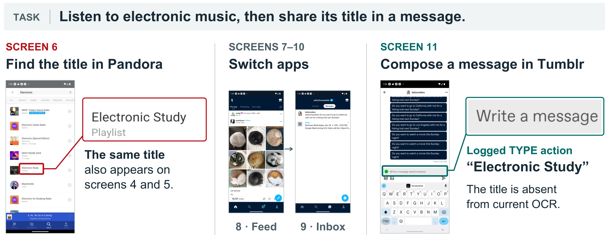
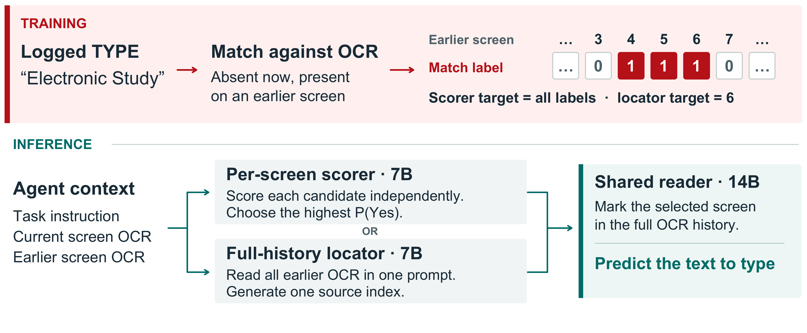

<h1 align="center">Verifier-Supervised Look-Back</h1>
<h3 align="center">for Delayed Information Needs in Mobile GUI Agents</h3>

<p align="center">
  Mingshuo Wang &nbsp;·&nbsp; North Carolina State University &nbsp;·&nbsp; Course final project, Fall 2026<br>
  <a href="doc/Final-Report.pdf"><b>Final report (PDF)</b></a> &nbsp;·&nbsp;
  <a href="doc/Slides.pdf"><b>Slides (PDF)</b></a> &nbsp;·&nbsp;
  <a href="doc/Slides.pptx">Slides (PowerPoint)</a>
</p>

<p align="center">
  
  
  
  
</p>

<p align="center">
  <a href="#overview">Overview</a> &nbsp;·&nbsp;
  <a href="#results">Results</a> &nbsp;·&nbsp;
  <a href="#getting-started">Getting started</a> &nbsp;·&nbsp;
  <a href="#paper-to-artifact-index">Paper-to-artifact index</a> &nbsp;·&nbsp;
  <a href="#artifact-contents">Code and data</a> &nbsp;·&nbsp;
  <a href="#citation">Citation</a>
</p>

On a long cross-app task, a mobile GUI agent sometimes has to type text that it
saw several screens earlier and that is no longer on the screen. In the
GUI-Odyssey episode below, the user listens to electronic music in Pandora, then
opens Tumblr to send its title, "Electronic Study", to a friend. At the message
box the title is gone: it last appeared on screen 6, five screens earlier. We
study this single typing decision. Given the task and the OCR text of the
current and earlier screens, can a model find an earlier screen that holds the
value, and then type the value correctly?

<p align="center">
  
</p>
<p align="center"><em>GUI-Odyssey episode 4671561041722435. "Electronic Study" appears on screens 4, 5 and 6 and is absent from the current OCR at step 11, where it is typed. The trained scorer selects screen 6 and the trained full-history selector selects screen 5. Both are valid sources, yet both reader outputs miss the recorded text. Screenshots cropped and annotated from GUI-Odyssey (CC BY 4.0).</em></p>

The demonstration already records the text the user typed. Matching it against
the OCR of every earlier screen labels which screens hold the answer, with no
human annotation and no teacher model. These labels train two Qwen2.5-7B LoRA
selectors: a per-screen scorer that answers Yes or No for each earlier screen,
and a full-history selector that reads all earlier screens and outputs one
screen index. A frozen Qwen2.5-14B reader then writes the text from the marked
screen. This repository holds the mining, training, reading and analysis code,
the derived OCR records and labels, and the per-case predictions behind the
report's tables and figures.

## Overview

<p align="center">
  
</p>

- **Labels from the demonstration.** A text entry becomes a case when its value
  (at least three normalized characters, not part of the task instruction) is
  absent from the current screen's OCR and present on at least one earlier
  screen. Each earlier screen with OCR is labeled 1 if a normalized substring
  match finds the value there and 0 otherwise. The recorded value is used only
  to build labels and to score outputs; the selectors and the reader never see
  it. The 188 development cases yield 2,861 labeled case–screen pairs, 463 of
  them positive.
- **Two selectors.** Both are Qwen2.5-7B-Instruct with rank-16 LoRA adapters on
  the attention projections. The per-screen scorer reads the task, the current
  OCR, one earlier screen's OCR and its distance, and is trained with weighted
  binary cross-entropy on its Yes/No answer. At test time it picks the
  highest-scoring screen. The full-history selector reads all earlier OCR in one
  prompt and is trained to generate the index of the latest matching screen.
- **Reader and evaluation.** A frozen Qwen2.5-14B-Instruct reader receives the
  task, all earlier OCR, the selected screen repeated and marked, and the
  current OCR, and writes the text to type. A selection counts as localized if
  the chosen screen is in the label set. Typed text counts as correct if the
  normalized output contains the recorded value. Development results pool five
  folds grouped by trajectory (188 cases from 182 trajectories). The 93 held-out
  cases come from 90 other trajectories and are scored once, by selectors fitted
  on all 188 development cases.

## Results

| Localization, dev (n = 188) | Typed text, dev (n = 188) | Localization, held out (n = 93) | Training labels |
| :---: | :---: | :---: | :---: |
| **50.0% → 72.3%** | **35.1% → 44.7%** | **41.9% → 79.6%** | **2,861 · 0 human labels** |

Each arrow compares the same Qwen2.5-7B per-screen scorer before and after LoRA
training on the derived labels, with the same prompt and the same 14B reader.

**Main results** (%, Table 2 of the report; best value per column in bold).

| Selector | Localization, dev | Typed text, dev | Localization, held out | Typed text, held out |
| :--- | ---: | ---: | ---: | ---: |
| Prompted screen index (14B) | 41.0 | 23.9 | 37.6 | 18.3 |
| Prompted full history (14B) | 54.8 | 31.4 | 59.1 | 23.7 |
| Untrained per-screen (7B) | 50.0 | 35.1 | 41.9 | – |
| Trained full history (7B) | 65.4 | 42.6 | 76.3 | **51.6** |
| Trained per-screen (7B) | **72.3** | **44.7** | **79.6** | 49.5 |

The three baselines are not trained. The screen index writes one short line (at
most 32 tokens) per earlier screen and asks the 14B model to pick a screen from
these lines. The full-history prompt gives the 14B model the numbered OCR
history and asks for the source screen. The untrained per-screen row uses the
scorer's base model and prompt without the adapter. The two per-screen rows
share the base model, prompt and reader, so their difference is the effect of
training: 94 → 136 correct localizations (52 gains, 10 losses, p < 0.001) and
66 → 84 correct text entries (23 gains, 5 losses, p = 0.0013), by two-sided
McNemar tests.

The prompted 14B rows read with their own setup (unmarked history on the first
batch, the selected screen alone elsewhere), so their typed-text scores are not
a controlled comparison. Paired tests do not separate the two trained selectors
(localization p = 0.086 on dev and p = 0.63 on held out). A correct screen does
not guarantee correct text: 62 of the scorer's 136 correct development
selections still miss the value. Each condition is a single training run, and
the dash marks a result that was not measured.

## Getting started

### Recount the headline numbers (CPU, standard library only)

Run this from the repository root with Python 3.10 or newer, either pasted into
`python` or saved as a file. It reads the saved per-case predictions in
`results/`.

```python
import json
from pathlib import Path
for split in ("", "_more"):
    for model in ("fullhist", "scorer"):
        path = Path("results") / f"{model}_trained{split}_hist_e2e.json"
        rows = json.loads(path.read_text(encoding="utf-8"))
        print(model, len(rows), sum(r["loc"] for r in rows), sum(r["e2e"] for r in rows))
```

Expected output (model, cases, correct localizations, correct typed text):

```text
fullhist 188 123 80
scorer 188 136 84
fullhist 93 71 48
scorer 93 74 46
```

These are the two trained rows of the main table. On dev, the full-history
selector gets 123/188 = 65.4% and 80/188 = 42.6%, and the scorer 136/188 =
72.3% and 84/188 = 44.7%. On held out, they get 71/93 = 76.3% and 48/93 =
51.6%, and 74/93 = 79.6% and 46/93 = 49.5%. In each row of these files, `loc`
is true when the selected screen is one of the case's valid screens, and `e2e`
is true when the normalized reader output contains the recorded text.

### Retrain the selectors and rerun the reader (Linux + CUDA)

You need a CUDA build of PyTorch, the packages in `requirements.txt`, and
access to `Qwen/Qwen2.5-7B-Instruct` and `Qwen/Qwen2.5-14B-Instruct` on Hugging
Face. The reported 7B training runs used one 48 GB GPU.

```bash
python -m pip install -r requirements.txt
```

The original programs read one flat data directory through absolute paths.
Stage the published inputs and results there, point `src/` at it once with
`configure.sh` (it edits `src/` in place; `git checkout -- src` undoes this),
train both selectors on the five folds and run the shared reader:

```bash
mkdir -p run-data
cp data/*.json* results/*.json run-data/
bash configure.sh "$PWD/run-data"
for f in 0 1 2 3 4; do
  FOLD=$f python src/train_scorer.py
  FOLD=$f python src/train_fullhist.py
done
for model in scorer fullhist; do
  PREFIX=$model SRC=trained HIST=1 python src/read_scorer.py
done
```

For the held-out batch, use `FOLD=ext` for both trainers, which fits each
selector once on all 188 development cases, and `SET=_more` for both read
stages:

```bash
FOLD=ext python src/train_scorer.py
FOLD=ext python src/train_fullhist.py
for model in scorer fullhist; do
  PREFIX=$model SRC=trained HIST=1 SET=_more python src/read_scorer.py
done
```

New predictions replace the staged copies in `run-data/` under the same file
names; the published ones stay in `results/`. To recount your own run, change
`Path("results")` to `Path("run-data")` in the snippet above.
`python src/analyze_all.py` prints the development and held-out aggregates,
ablations and paired tests from `run-data/` on a CPU (its labels are in
Chinese). Commands for the untrained control, ablations, read controls,
prompted baselines and re-mining from raw GUI-Odyssey data are in
[Further details](#further-details).

## Paper-to-artifact index

Where each item in the [final report](doc/Final-Report.pdf) comes from. Result
files are in `results/` and programs in `src/` unless a path says otherwise.

| Report item | Saved results | Code |
| --- | --- | --- |
| Table 1: sampling and case retention | Sampled trajectories, with candidate entries under `hits`: `sample300.json`, `sample_long.json`, `sample_holdout.json`, `sample_more.json`. Retained cases: `cases_clean.json` rows selected by `clean_idx_short.json`, `cases_long.json` rows selected by `clean_idx_long.json`, `cases_holdout.json`, `cases_more.json` | `sample_and_fetch.py`, `sample_long.py`, `sample_holdout.py`, `sample_more.py`, `verify_and_bm25.py`, `verify_long.py`, `verify_holdout.py`, `verify_more.py` |
| §2.1–2.2 and §3.1: labels and folds (2,861 pairs, 463 positive; folds of 38, 40, 37, 37 and 36 cases) | `scorer_cases.json`, `scorer_pairs.json`; held out: `scorer_cases_more.json`, `scorer_pairs_more.json`. Valid screens per batch: `valid_screens.json`, `valid_screens_long.json`, `valid_screens_holdout.json`, `valid_screens_more.json` | `build_scorer_data.py`, `build_scorer_more.py`, `fix_metric.py` |
| Figure 1: Pandora → Tumblr example | Case 0 of `scorer_cases.json`; selections in `scorer_trained_hist_e2e.json` and `fullhist_trained_hist_e2e.json`; image `media/readme/scenario.png` | `doc/report-src/figures/draw_figures.py`, from the episode's screenshots and annotation in `doc/report-src/figures/assets/` |
| Figure 2: method | Image `media/readme/method.png` | `doc/report-src/figures/draw_figures.py` |
| Table 2: prompted screen index and full history (14B) | Dev: fields `E` (index) and `B` (full history) of `scorer_eval_rows.json` (localization) and `scorer_e2e_rows.json` (typed text), collected from `full_matrix_result.json`, `eval_long_B_result.json`, `eval_long_D_result.json`, `eval_holdout_B_result.json`, `eval_holdout_D_result.json`. Held out: `eval_more_D_result.json`, `eval_more_B_result.json` | `full_matrix.py`, `eval_long.py`, `eval_scorer.py` (writes `scorer_eval_rows.json`) |
| Table 2: untrained per-screen (7B) | `scorer_untrained_probs.json`, `scorer_untrained_hist_e2e.json`; held out: `scorer_untrained_more_probs.json` | `score_untrained.py`, `read_scorer.py` |
| Table 2: trained full history (7B) | `fullhist_fold[0-4]_probs.json`, `fullhist_trained_hist_e2e.json`; held out: `fullhist_foldext_probs.json`, `fullhist_trained_more_hist_e2e.json` | `train_fullhist.py`, `read_scorer.py` |
| Table 2: trained per-screen (7B) | `scorer_fold[0-4]_probs.json`, `scorer_trained_hist_e2e.json`; held out: `scorer_foldext_probs.json`, `scorer_trained_more_hist_e2e.json` | `train_scorer.py`, `read_scorer.py` |
| §3.2: single-screen versus history-aware reading on held out (37.6% → 49.5%) | `scorer_trained_more_e2e.json`, `scorer_trained_more_hist_e2e.json` | `read_scorer.py` (`HIST=0` or `HIST=1`) |
| §3.2: aggregates, step subsets and paired tests | The Table 2 files above | `analyze_all.py`, `eval_scorer.py` |
| §3.3: finding the screen versus reading it (74 of 136 correct selections also give the correct text) | `loc` and `e2e` per case in `scorer_trained_hist_e2e.json`; held out: `scorer_trained_more_hist_e2e.json` | `read_scorer.py` |
| Figure 3: localization by distance to the first or most recent match | `t` and `valid` in `scorer_cases.json`; field `B` of `scorer_eval_rows.json`; `loc` in `fullhist_trained_hist_e2e.json` and `scorer_trained_hist_e2e.json` | `doc/report-src/figures/plot_distance.py`, which groups cases by `t - min(valid)` or `t - max(valid)` |
| Table 3: selector variations | `scorer_nodist_fold[0-4]_probs.json`, `scorer_posw1_fold[0-4]_probs.json`, `scorer_3B_fold[0-4]_probs.json` | `train_scorer.py` (`NODIST`, `POSW`, `MODEL`), `analyze_all.py` |
| Table 3: reader highlight | `scorer_trained_hist_e2e.json`, `scorer_trained_hist_top2_e2e.json`, `scorer_trained_hist_gold_e2e.json`, `scorer_trained_hist_recent_e2e.json`, `scorer_trained_hist_random_e2e.json` | `read_scorer.py` (`MARK`) |
| §3.5: why a screen index falls short (first 85 cases) | `full_matrix_result.json` (`E` index, `B` full OCR, `C` summary); writer variants `eval_r1_result.json` (preference-trained), `eval_r2_result.json`, `eval_r3_result.json`, `eval_mv3_result.json`, `eval_rp_result.json`; preference pairs `dpo_pairs.json`; index entries `data/directory_*.jsonl` | `gen_directory.py`, `train_writer.py`, `gen_directory_r1.py`, `gen_directory_r2.py`, `gen_directory_r3.py`, `gen_directory_rp.py`, `gen_multiview.py`, `eval_r1.py`, `eval_mv.py`, `full_matrix.py` |
| §3.5: BM25 with the task and current screen (10.6%) or the hidden answer (92.9%) as query | Not stored per case for the 85-case set. `hybrid_result.json` keeps BM25 top-1 hits against the earliest source for the 118 first-batch cases | `stage1_full.py`, `verify_and_bm25.py`, `hybrid_baseline.py`; see EXPERIMENT-LOG.md §3.1 |
| §3.5: evaluation filter 1, credit every valid screen | `valid_screens.json`; strict flag and predicted index per case in `full_matrix_result.json` | `fix_metric.py`; see EXPERIMENT-LOG.md §3.10 |
| §3.5: evaluation filter 2, current-screen leakage | `cases_long.json` (127 unfiltered cases), `clean_idx_long.json` (53 retained), `eval_long_B_result.json`, `eval_long_C2_result.json`, `eval_long_GATE_result.json` | `analyze_gate.py` (cross-validated gate), `eval_gate_e2e.py`, `verify_long.py`; see EXPERIMENT-LOG.md §3.19.13–3.19.15 and §3.21 |

Notes on the files. First-batch files index cases either in `cases.json` order
(127 rows, for example `full_matrix_result.json`) or in `cases_clean.json` order
(118 rows after dropping `bad_idx.json`, for example `valid_screens.json` and
`eval_r1_result.json`); `clean_idx_short.json` selects the 85 retained cases.
`scorer_cases.json` lists each development case's episode ID, step `t`,
recorded value `ans`, fold and all valid earlier screen IDs `valid`. Its `gap`
field equals `t - min(valid)`, the distance to the first occurrence; the
shortest available look-back is `t - max(valid)`. The two differ on 111 of 188
development cases, and the full-history training target uses `max(valid)`.
Development fold files key cases by their index in `scorer_cases.json`; the
held-out files of the trained selectors (`*_foldext_probs.json`) start their
keys at 188.

## Artifact contents

| Path | Contents |
| --- | --- |
| [`src/`](src/) | 54 Python programs and 33 Bash drivers for sampling, OCR, label mining, training, reading, evaluation and analysis. A per-file index is under [Source code index](#source-code-index). |
| [`data/`](data/) | Derived inputs: EasyOCR records for 19,330 sampled screenshots (`parse_odyssey.jsonl`; `parse_more.jsonl` repeats the 4,802 held-out-batch screens), model-written screen-index entries (`directory_*.jsonl`), and `screenshot_index.json`, which maps all 118,791 GUI-Odyssey screenshot names to their release folders. |
| [`results/`](results/) | 112 JSON files: sample manifests, case lists, valid-screen sets, case–screen pairs with fold assignments, per-fold selector scores, reader outcomes and earlier comparisons. |
| [`doc/Final-Report.pdf`](doc/Final-Report.pdf) | Final report (9 pages). |
| [`doc/Slides.pdf`](doc/Slides.pdf), [`doc/Slides.pptx`](doc/Slides.pptx) | Final presentation (18 slides). |
| [`doc/report-src/`](doc/report-src/) | LaTeX source of the report (`main.tex`, which inputs `results.tex` and `closing.tex`) and `build.sh`. Figure scripts: `doc/report-src/figures/draw_figures.py` draws Figures 1 and 2 from one episode's screenshots and annotation in `doc/report-src/figures/assets/`, and `doc/report-src/figures/plot_distance.py` draws Figure 3 from `results/`. |
| [`doc/slides-src/`](doc/slides-src/) | `build_slides.py` builds the deck from `ncsu_template.pptx` and the images in `doc/slides-src/assets/`; `export_pdf.ps1` exports the PDF through PowerPoint. |
| [`media/readme/`](media/readme/) | The two figures in this README. |
| [`EXPERIMENT-LOG.md`](EXPERIMENT-LOG.md) | Chronological experiment record, in Chinese, including retracted comparisons and the current-screen leakage finding. |
| [`configure.sh`](configure.sh) | Rewrites the absolute data and interpreter paths in `src/` to point at a local staging directory. |
| [`requirements.txt`](requirements.txt) | Third-party packages used by `src/`. The figure and slide builders under `doc/` also need matplotlib, PyMuPDF, Pillow, reportlab, python-pptx and lxml. |

### Main entry points

| Purpose | Entry point |
| --- | --- |
| Point the programs at a local staging directory | `configure.sh` |
| Sample held-out trajectories and fetch their screenshots | `src/sample_more.py` |
| Run OCR on fetched screenshots | `src/ocr_shots.py` |
| Mine held-out cases and label every earlier screen | `src/verify_more.py` |
| Build case–screen pairs and trajectory-grouped folds | `src/build_scorer_data.py`, `src/build_scorer_more.py` |
| Train the per-screen scorer and its ablations | `src/train_scorer.py` |
| Train the full-history selector | `src/train_fullhist.py` |
| Score candidates with the untrained base model | `src/score_untrained.py` |
| Run the 14B reader on a selector's choices | `src/read_scorer.py` |
| Run the prompted full-history and screen-index baselines | `src/eval_long.py` |
| Print aggregate tables and paired tests on a CPU | `src/analyze_all.py` |
| Redraw Figure 3 from the saved predictions | `doc/report-src/figures/plot_distance.py` |
| Rebuild the report and the slides | `doc/report-src/build.sh`, `doc/slides-src/build_slides.py` |

## Source code index

The tables below index all 54 Python programs and 33 Bash drivers under
`src/`, grouped by role. Each row names the functions and classes defined in
those files. “Module body” and “Script body” mean the work runs directly from
top-level statements. The first, long, third and fourth samples are the four
batches of Table 1 (first, long, later-mined and held-out batch); the fourth
sample is the 93-case held-out batch. “Directory” in file names and
descriptions means the screen index of the report. The index also covers the
earlier screen-directory experiments recorded in the experiment log.

<details>
<summary><strong>Helper functions shared across programs</strong></summary>

**Recurring Python helpers.** `norm` lowercases text and removes whitespace and the punctuation specified in that file. The mining routines remove commas, and several evaluation routines also remove periods. `toks` extracts lowercase alphanumeric tokens for BM25 or set overlap. `gen` generates and decodes a bounded model response. `pct` and `acc` express successful cases as a percentage. `mc` computes the paired net difference and the continuity-corrected asymptotic McNemar p-value. `L` reads a JSON artifact when it exists.

**Prompt helpers.** `prompt` constructs the task-specific model input. `prompt_for` formats a writer prompt for one screen. `score_prompt` formats the independent candidate-screen Yes/No question. `p_locate` requests a screen index. `p_read` requests the text to enter. The individual programs below specify the information each prompt can see.

</details>

<details>
<summary><strong>Mining and labeling</strong> (13 programs)</summary>

| Program | Purpose | Functions and classes |
| --- | --- | --- |
| [sample_and_fetch.py](src/sample_and_fetch.py) | Samples 300 eligible episodes and downloads indexed frames across each episode. `get` retrieves one image, skips an existing download and retries transfer failures. | `norm`, `get` |
| [sample_long.py](src/sample_long.py) | Samples long episodes outside the first sample. The minimum episode length, earliest eligible input step and sample size are configurable. `get` retrieves a frame through the last selected input. | `norm`, `get` |
| [sample_holdout.py](src/sample_holdout.py), [sample_more.py](src/sample_more.py) | Draws the third and fourth samples. The third excludes the previous two manifests and the fourth excludes all three. `get` downloads each required frame through the last selected input. | `norm`, `get` |
| [ocr_shots.py](src/ocr_shots.py) | Runs English EasyOCR on new PNGs. Appends text, bounding box and confidence for retained detections. | Module body |
| [ocr_shard.py](src/ocr_shard.py) | Splits the remaining ordered image list by shard number and appends each worker’s OCR results to its configured output. | Module body |
| [verify_and_bm25.py](src/verify_and_bm25.py) | Mines earliest OCR matches in the first sample before the final leakage filters. `frame_text` joins detected strings. `BM25.__init__` builds token statistics, `BM25.score` scores each earlier screen, and `evaluate` computes retrieval recall and rank for context and oracle queries. | `norm`, `toks`, `frame_text`, `BM25`, `BM25.__init__`, `BM25.score`, `evaluate` |
| [verify_long.py](src/verify_long.py), [verify_holdout.py](src/verify_holdout.py) | Requires current-screen OCR, excludes values visible there, and writes each case’s earliest source, distance and all matching earlier screen IDs for the second and third samples. | `norm` |
| [verify_more.py](src/verify_more.py) | Applies the fourth-sample verifier and also excludes values found in the step-by-step instruction field. | `norm` |
| [fix_metric.py](src/fix_metric.py) | Rebuilds the first sample’s full set of valid historical screen IDs from cleaned cases and OCR for any-valid localization scoring. | `norm` |
| [build_scorer_data.py](src/build_scorer_data.py) | Joins the three development lists with task and current OCR, groups by episode for five folds and emits a binary training pair for each readable earlier screen. | Module body |
| [build_scorer_more.py](src/build_scorer_more.py) | Produces the corresponding fourth-sample case and pair files. Training on the development pool holds these cases out for evaluation. | Module body |

</details>

<details>
<summary><strong>Training the selectors</strong> (3 programs)</summary>

| Program | Purpose | Functions and classes |
| --- | --- | --- |
| [train_scorer.py](src/train_scorer.py) | Trains a LoRA-adapted Yes/No screen scorer with weighted cross-entropy. `enc` tokenizes the candidate prompt. Exports per-case candidate scores for held-out folds or external evaluation. | `prompt`, `enc` |
| [score_untrained.py](src/score_untrained.py) | Scores the same candidate task with the base model to provide the untrained comparison. | `prompt` |
| [train_fullhist.py](src/train_fullhist.py) | Fine-tunes a full-history locator on the latest verifier-positive screen index and saves its generated index for each evaluated case. | `prompt` |

</details>

<details>
<summary><strong>Reading and evaluation</strong> (12 programs)</summary>

| Program | Purpose | Functions and classes |
| --- | --- | --- |
| [read_scorer.py](src/read_scorer.py) | Takes retriever predictions, chooses the marked screen(s) for the configured control, prompts the 14B reader and saves per-case localization and text-recovery results. | `norm`, `gen` |
| [eval_scorer.py](src/eval_scorer.py) | Pools per-fold predictions and checks the top screen against each valid set. `report` summarizes a selected subset and compares paired outcomes with prompted baselines. | `pct`, `mc`, `report` |
| [eval_long.py](src/eval_long.py) | Evaluates prompted full-history or directory localization and text readout for a chosen case set. Saves per-case progress for resumption. | `norm`, `gen` |
| [eval_r1.py](src/eval_r1.py) | Evaluates a chosen directory using one index-selection call followed by a read of the selected screen. Its historical localization flag uses the recorded first source. | `norm`, `gen` |
| [eval_mv.py](src/eval_mv.py) | Changes how many sampled descriptions per screen the locator sees and reads the selected screen’s OCR. | `norm`, `gen` |
| [eval_seg.py](src/eval_seg.py) | Ablates the fields of a structured entry. `segof` extracts the left field, the right field or the full line. | `segof`, `norm`, `gen` |
| [eval_perscreen.py](src/eval_perscreen.py) | Scores directory entries one screen at a time with Yes/No logits, selects the strongest candidate and reads its OCR. | `norm`, `score_prompt`, `gen` |
| [eval_router.py](src/eval_router.py) | Adds screen-score confidence features to the per-screen directory reader’s output for offline routing experiments. | `norm`, `score_prompt`, `gen` |
| [eval_hybrid.py](src/eval_hybrid.py) | Uses full OCR for the most recent screens and short directory entries for older ones. Varies the recent window and optional recency prompt. | `norm`, `gen` |
| [eval_twopass.py](src/eval_twopass.py) | Searches the latest K OCR screens first. A first-pass abstention triggers a second search over older entries. | `norm`, `gen` |
| [eval_calib.py](src/eval_calib.py) | Records two candidate decisions for retrospective threshold selection. `pyes` computes a Yes/No probability for a recent candidate. | `norm`, `pyes`, `gen` |
| [eval_gate_e2e.py](src/eval_gate_e2e.py) | Uses recent-versus-older lexical overlap to choose a candidate, then reads its OCR and evaluates the predicted text. | `norm`, `toks`, `gen` |

</details>

<details>
<summary><strong>Analysis</strong> (8 programs)</summary>

| Program | Purpose | Functions and classes |
| --- | --- | --- |
| [analyze_all.py](src/analyze_all.py) | Aggregates available retriever, ablation, top-two and external artifacts. `load_probs` merges fold probability files and counts loaded folds. `loc_of` checks each highest-scoring candidate against the valid screen IDs. | `L`, `pct`, `mc`, `load_probs`, `loc_of` |
| [analyze_long.py](src/analyze_long.py) | Compares the long-sample full-history and directory outcomes by need step and distance using paired tests. | `mc`, `pct` |
| [analyze_hybrid.py](src/analyze_hybrid.py) | Compares the hybrid history variants with full-history and directory baselines across the short and long samples. `load` reads one result file by tag. | `mc`, `pct`, `load` |
| [analyze_calib.py](src/analyze_calib.py) | Evaluates a confidence threshold using cross-validation. `route` selects the first- or second-pass result on each case. | `route`, `acc`, `mc` |
| [analyze_gate.py](src/analyze_gate.py) | Compares token overlap between the current screen and recent or older screens, then evaluates threshold routing against baseline results. | `toks`, `pct`, `mc` |
| [analyze_router.py](src/analyze_router.py) | Tests confidence-based routing. `sigval` orients each confidence feature. `route_acc` and `route3` count correct choices for two and three routes. `best_thr` and `best_thr3` fit one or two cutoffs using the training subset. | `sigval`, `route_acc`, `best_thr`, `route3`, `best_thr3` |
| [analyze_finish.py](src/analyze_finish.py) | Prints short, long and held-out comparisons across reader settings. `sig` flags a p-value below .05, `sub` selects case indices and `table` prints localization, text recovery and paired comparisons. | `L`, `mc`, `pct`, `sig`, `sub`, `table` |
| [fill_holdout.py](src/fill_holdout.py) | Computes historical held-out paired comparisons and edits the corresponding table row in a local draft LaTeX results file. | `pct`, `mc` |

</details>

<details>
<summary><strong>Screen-index experiments and earlier baselines</strong> (18 programs)</summary>

| Program | Purpose | Functions and classes |
| --- | --- | --- |
| [stage1_full.py](src/stage1_full.py) | Tests BM25 with three screen representations. `verbatim` joins OCR, `heuristic` combines app names with the first eight spatially sorted OCR items and `llmdir` reads a generated entry. `BM25.__init__` indexes tokens, `BM25.rank` returns scores and `run` summarizes recall for a representation and query type. | `norm`, `toks`, `verbatim`, `heuristic`, `llmdir`, `BM25`, `BM25.__init__`, `BM25.rank`, `run` |
| [fullhist_llm.py](src/fullhist_llm.py) | Compares text generation with current context, full history or a known source. `build` assembles the matching prompt. | `norm`, `build` |
| [fullhist_locate.py](src/fullhist_locate.py) | Separately measures source-index prediction from full OCR history and text generation given the recorded source. | `norm`, `p_locate`, `p_read`, `gen` |
| [full_matrix.py](src/full_matrix.py) | Runs current-only, full OCR, summary and directory conditions plus a known-source read. `hist_block` selects the history representation. The two prompt helpers construct the locator and readout inputs. | `norm`, `gen`, `hist_block`, `p_locate`, `p_read` |
| [hybrid_baseline.py](src/hybrid_baseline.py) | Compares BM25 shortlisting with an LLM reranker and rank fusion. `bm25_order` returns document indices in lexical relevance order. The local lambda `f` reports accuracy in a distance bin. | `toks`, `norm`, `bm25_order`, `gen`, `f` |
| [gen_directory.py](src/gen_directory.py), [gen_directory_long.py](src/gen_directory_long.py), [gen_directory_holdout.py](src/gen_directory_holdout.py), [gen_directory_more.py](src/gen_directory_more.py) | Writes short prompt-only OCR entries for the original, long, third and fourth samples respectively. All four append to the base directory file and skip entries already present. | `prompt_for` |
| [gen_directory_r1.py](src/gen_directory_r1.py) | Loads the trained writer adapter and regenerates directory entries. | Module body |
| [gen_directory_r2.py](src/gen_directory_r2.py) | Prompts for a two-part entry containing a screen’s subject and the types of values available. | `prompt_for` |
| [gen_directory_r3.py](src/gen_directory_r3.py) | Prompts for distinctive concrete values from the source OCR. | `prompt_for` |
| [gen_directory_rp.py](src/gen_directory_rp.py) | Applies the oracle experiment’s sampled writer prompt to every required screen and saves one entry per screen. | Module body |
| [gen_multiview.py](src/gen_multiview.py) | Samples several alternative descriptions of each screen for the multiview comparison. | `prompt_for` |
| [oracle_directory.py](src/oracle_directory.py), [oracle_fixed.py](src/oracle_fixed.py) | Substitutes sampled descriptions for the recorded source’s directory entry and checks whether any enables retrieval. `locate` runs the locator prompt and parses the predicted index. The second program also evaluates membership in the full valid set. | `norm`, `gen`, `p_locate`, `locate` |
| [train_writer.py](src/train_writer.py) | Trains the writer adapter on preferred and rejected descriptions. `encode` tokenizes prompt/response pairs and marks the response boundary. `seq_logp` sums response-token log probabilities under the policy or reference. `batch_loss` computes the direct preference optimization loss and pair accuracy. | `encode`, `seq_logp`, `batch_loss` |
| [cmp_r2.py](src/cmp_r2.py) | Compares r0, r1 and r2 directory quality. `load` reads image-to-entry mappings. `fieldrate` counts recognized right-field labels, `genrate` counts generic left descriptions, `intra` compares entries within episodes, and `discrim` finds each source’s most similar distractor by token-set overlap. The local lambda `fmt` formats the resulting table values. | `toks`, `load`, `fieldrate`, `genrate`, `intra`, `discrim`, `fmt` |

</details>

<details>
<summary><strong>Shell launchers</strong> (33 Bash drivers)</summary>

**Shell helpers.** `pick` and `pick_gpu` wait for an eligible GPU and return its index. `free_of` estimates free memory for the specified card using the original machine’s configured capacity. `run` skips a completed output and retries the requested job. `run14` schedules the 14B model across two cards and `run1` runs a job on a single eligible card. The driver table lists only the helpers defined in each file.

| Program | Purpose | Functions and classes |
| --- | --- | --- |
| [run_scorer.sh](src/run_scorer.sh) | Trains and scores the five development folds of the per-screen model. | Script body |
| [run_exp.sh](src/run_exp.sh) | Runs full-history training, the no-distance, unit-weight and 3B scorer ablations, and top-two readout on a selected GPU. | Script body |
| [run_exp2.sh](src/run_exp2.sh) | Runs the same comparison set with GPU selection, completed-output checks and retries. | `free_of`, `pick`, `run` |
| [run_read.sh](src/run_read.sh) | Runs single-screen readout for trained and untrained per-screen predictions. | Script body |
| [run_marks.sh](src/run_marks.sh) | Evaluates history readout with oracle, most recent and random screen marks. | Script body |
| [run_fhread.sh](src/run_fhread.sh) | Runs both marked-history and single-screen readout on the trained full-history locator’s development predictions. | `free_of`, `pick` |
| [run_ext.sh](src/run_ext.sh) | Waits for fourth-sample download completion, merges OCR, verifies cases, creates directory entries and pairs, and runs trained/untrained scorer, prompted baselines and readouts. | `free_of`, `pick` |
| [run_ext2.sh](src/run_ext2.sh) | Retries the external per-screen scorer’s marked-history readout. | `free_of`, `pick` |
| [run_fh_ext.sh](src/run_fh_ext.sh) | Trains the full-history locator on all development examples and localizes the fourth sample. | `free_of`, `pick` |
| [run_fill.sh](src/run_fill.sh) | Runs external marked-history readout for the full-history locator and development marked-history readout for the untrained scorer. | `free_of`, `pick`, `run` |
| [run_closeloop.sh](src/run_closeloop.sh) | Trains the preference-based writer, regenerates its directory and evaluates it. | Script body |
| [run_rest.sh](src/run_rest.sh) | Runs source-entry oracle substitution and the BM25/LLM hybrid baseline. | Script body |
| [run_r2.sh](src/run_r2.sh) | Waits for r2 entry generation and evaluates that directory. | Script body |
| [run_r3.sh](src/run_r3.sh), [run_r3b.sh](src/run_r3b.sh) | Generates and evaluates r3 entries. The second driver additionally runs the any-valid oracle evaluation. | Script body |
| [run_rp.sh](src/run_rp.sh) | Generates and evaluates the directory written with the oracle sampling prompt. | Script body |
| [run_seg.sh](src/run_seg.sh) | Waits for the r2 evaluation, then runs the left-only and right-only entry ablations. | Script body |
| [run_mv.sh](src/run_mv.sh) | Generates three descriptions per screen and evaluates access to one versus three. | Script body |
| [run_ps.sh](src/run_ps.sh) | Compares per-screen scoring on base entries and three-view entries. | Script body |
| [wait_and_run_ps.sh](src/wait_and_run_ps.sh) | Waits for GPU 0 to meet a memory threshold, then launches the per-screen comparison. | Script body |
| [run_router.sh](src/run_router.sh) | Runs multiview per-screen scoring with routing features recorded. | Script body |
| [run_long.sh](src/run_long.sh) | Waits for the long-sample download and runs OCR, verification, indexing and prompted evaluations. | Script body |
| [run_long2.sh](src/run_long2.sh) | Resumes the long-sample prompted full-history and directory runs with a GPU wait before each. | `pick_gpu` |
| [run_long3.sh](src/run_long3.sh), [run_long4.sh](src/run_long4.sh) | Retries long-sample prompted evaluations. The third driver runs full history first. The fourth starts with the directory and assigns condition-specific memory requirements. | `pick_gpu` |
| [run_long5.sh](src/run_long5.sh) | Retries only the long-sample full-history condition on one GPU. | `pick_gpu` |
| [run_long6.sh](src/run_long6.sh) | Runs the same full-history condition across two GPUs using dynamic memory caps. | `free_of` |
| [run_hybrid.sh](src/run_hybrid.sh) | Evaluates the recent-window hybrid with and without the recency prompt on short and long samples. | `pick` |
| [run_ksweep.sh](src/run_ksweep.sh) | Tests one- and three-screen recent windows on the long sample. | `pick` |
| [run_twopass.sh](src/run_twopass.sh) | Runs the recent-first two-pass reader with a two-screen recent window. | `pick` |
| [run_calib.sh](src/run_calib.sh), [run_calib_short.sh](src/run_calib_short.sh) | Runs the calibrated two-pass reader on the long and short samples respectively. | `pick` |
| [run_finish.sh](src/run_finish.sh) | Runs the lexical gate, 7B reader comparisons and third-sample OCR, verification, indexing and prompted evaluations. | `free_of`, `run14`, `run1` |

</details>

## Further details

<details>
<summary><strong>All rerun commands</strong></summary>

Run these from the repository root of a fresh Linux clone, after the staging
and `configure.sh` steps in [Getting started](#getting-started). The GPU runs
need CUDA-compatible PyTorch, Transformers with Qwen2.5 support, PEFT,
Accelerate and access to the Qwen2.5-7B/14B-Instruct weights. The smaller
ablation also uses Qwen2.5-3B-Instruct. `read_scorer.py` and `eval_long.py`
place the 14B model with `device_map='auto'`; the optional `MAXMEM` variable,
a JSON map such as `{"0":"22GiB","1":"22GiB"}`, caps the memory used on each
GPU. New runs write to `run-data/`, and the aggregate analysis reads the staged
files and runs on a CPU.

**Development pool: both selectors, the untrained control and the reader.**

```bash
for fold in 0 1 2 3 4; do
  FOLD=$fold python src/train_scorer.py
  FOLD=$fold python src/train_fullhist.py
done
python src/score_untrained.py
SRC=untrained HIST=1 python src/read_scorer.py
SRC=trained HIST=1 python src/read_scorer.py
SRC=trained HIST=1 PREFIX=fullhist python src/read_scorer.py
python src/eval_scorer.py
```

**Ablations and reading controls.** Use the base scorer's five fold files from
the preceding block. The 3B, no-distance and unit-positive-weight variants
write separately named predictions.

```bash
for fold in 0 1 2 3 4; do
  FOLD=$fold TAG=_nodist NODIST=1 python src/train_scorer.py
  FOLD=$fold TAG=_posw1 POSW=1 python src/train_scorer.py
  FOLD=$fold TAG=_3B MODEL=Qwen/Qwen2.5-3B-Instruct python src/train_scorer.py
done
for mark in gold recent random top2; do
  SRC=trained HIST=1 MARK=$mark python src/read_scorer.py
done
SRC=trained HIST=0 python src/read_scorer.py
```

**Held-out batch (fourth sample).** Train on all 188 development cases and
evaluate the disjoint sample. The published case and pair files already contain
the task descriptions needed by these retrievers. The main results table uses
the same 14B reader with the whole history and the selected screen marked for
both trained models.

```bash
FOLD=ext python src/train_scorer.py
FOLD=ext python src/train_fullhist.py
SET=_more python src/score_untrained.py
SET=_more SRC=trained HIST=0 python src/read_scorer.py
SET=_more SRC=trained HIST=1 python src/read_scorer.py
SET=_more SRC=trained HIST=1 PREFIX=fullhist python src/read_scorer.py
python src/analyze_all.py
```

**Re-mine from the original corpus.** Place the source annotation JSON files
under `run-data/annotations/` and install EasyOCR for fresh OCR.
`sample_more.py` uses the three staged sample manifests to exclude previous
trajectories, plus the staged screenshot index to fetch images. The OCR pass
skips images with existing records. `verify_more.py` checks candidate text
against the current screen, earlier screens and the instruction field.
`build_scorer_more.py` then recreates the external task/candidate pairs. The
prompted baselines read original annotations for task descriptions.

```bash
MINLEN=16 MINT=12 N=400 python src/sample_more.py
python src/ocr_shots.py
python src/verify_more.py
python src/build_scorer_more.py
CASES=more MODE=B python src/eval_long.py
CASES=more MODE=D python src/eval_long.py
```

The first three samples use `sample_and_fetch.py`, `sample_long.py` and
`sample_holdout.py`. Their committed manifests fix the actual sample
membership. The raw comparison scripts and historical shell drivers retain
machine-specific settings used in those runs. Each reported training condition
used a single run per fold. Paired tests measure disagreement on the same
cases. The held-out trajectories share a corpus and OCR engine with the
development data.

</details>

<details>
<summary><strong>Data provenance, licensing and attribution</strong></summary>

- **Source data.** Screens and human demonstrations come from the first public
  release of [GUI-Odyssey](https://huggingface.co/datasets/OpenGVLab/GUI-Odyssey)
  (7,735 trajectories; Lu et al., arXiv:2406.08451). The later ICCV 2025 paper
  describes an expanded release. GUI-Odyssey screenshots are licensed under
  CC BY 4.0. The screenshots in `media/readme/scenario.png` are cropped and
  annotated from episode 4671561041722435.
- **What is redistributed.** Apart from the four screenshots and the annotation
  file of episode 4671561041722435 that Figure 1 is drawn from
  (`doc/report-src/figures/assets/`), no GUI-Odyssey screenshots or annotation
  files are included: `.gitignore` excludes `shots/` and `annotations/`, and
  the sampling programs download the frames they need from the Hugging Face
  dataset using `data/screenshot_index.json`. Otherwise the repository ships
  derived records only:
  EasyOCR text, boxes and confidences (`data/parse_*.jsonl`), model-written
  screen-index entries (`data/directory_*.jsonl`), and case lists, labels and
  predictions (`results/`). They are derived from the CC BY 4.0 screenshots, so
  credit GUI-Odyssey when you reuse them.
- **External components.** EasyOCR provides character recognition, Hugging Face
  Transformers loads the Qwen2.5 models and computes logits/generations, PEFT
  supplies the LoRA adapters, and PyTorch handles tensor operations and
  optimization. The Qwen2.5-3B/7B/14B-Instruct weights are downloaded from
  Hugging Face under their own licenses. The original image collection,
  annotation directory, base models and trained writer adapter are external to
  this checkout. AITZ supplies only the short-task comparison recorded in
  EXPERIMENT-LOG.md; no AITZ data is included.
- **Author's code.** The author implemented the candidate and leakage filters,
  grouped folds, verifier labels, retriever prompts and training loops,
  weighted binary objective, writer preference loss, screen-index variants,
  BM25 baselines, reader controls, metrics, paired tests and run drivers.
- **License.** The repository does not include a license file for its own code.
- **Citing the data.** If you use these records, please also cite GUI-Odyssey
  (Lu et al., ICCV 2025).

</details>

<details>
<summary><strong>Known limitations</strong></summary>

- **One corpus and one OCR engine.** All four batches come from the first
  GUI-Odyssey release and use English EasyOCR. The 93 held-out cases come from
  disjoint trajectories of the same corpus, not from a second dataset.
- **Label noise.** A substring match can be coincidental, and OCR errors or
  paraphrases can hide true matches. A 20-case spot check found the target
  visible in every inspected source screen; in five of those cases the user had
  entered the value earlier, so the need for memory is weaker there.
  EXPERIMENT-LOG.md §5 breaks down the first-batch candidates that the OCR check
  did not confirm.
- **The metrics cover one typing decision.** The action type and the need to
  look back are given. Localization uses the same matching rule that produces
  the training labels, and typed-text accuracy accepts the recorded value inside
  a longer output. Neither metric measures whole-task success on a device.
- **Single runs.** Each condition is one training run per fold. The p-values
  are nominal and reflect case-level variance only.
- **Long look-backs stay weak.** On the 14 development cases whose most recent
  evidence is at least 13 screens old, prompted full history finds 8 sources,
  the trained full-history selector 4 and the scorer 3.
- **Historical scripts.** Many programs and shell drivers keep settings from the
  original machine, such as GPU selection; `configure.sh` rewrites only the
  paths. Some code comments and printed output are in Chinese.

</details>

## Citation

```bibtex
@misc{wang2026lookback,
  title  = {Verifier-Supervised Look-Back for Delayed Information Needs in Mobile {GUI} Agents},
  author = {Wang, Mingshuo},
  year   = {2026},
  note   = {Course project report, North Carolina State University},
  url    = {https://github.com/WMSlalalala/verifier-supervised-lookback}
}
```
